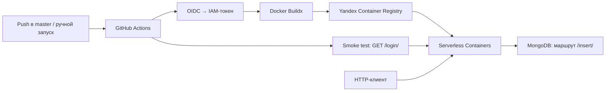

# express-week6

Учебный backend на Node.js и Express с контейнеризацией и автоматическим деплоем в Yandex Cloud Serverless Containers. Проект показывает полный путь от исходного кода до облачной ревизии: Docker → Container Registry → Serverless Containers, с авторизацией CI через OIDC и IAM.

## Стек

- Node.js 22 (в Docker), Express 5, ES Modules.
- `body-parser` для обработки HTML-форм, драйвер `mongodb` 3.4.
- Docker и Buildx для сборки образа `linux/amd64`.
- GitHub Actions для сборки, публикации, деплоя и smoke test.
- Yandex Container Registry, Serverless Containers, IAM и федеративная авторизация OIDC.

## Архитектура



`index.js` импортирует зависимости, передаёт их в фабрику `appSrc(...)` и запускает сервер. `app.js` создаёт Express-приложение, настраивает middleware и маршруты. Создание приложения отделено от открытия сетевого порта.

MongoDB подключается только при вызове `/insert/`; соединение закрывается после операции. База данных не создаётся workflow и должна быть доступна отдельно.

## Структура проекта

```text
.
├── .github/workflows/deploy.yml  # CI/CD в Yandex Cloud
├── app.js                        # Middleware и HTTP-маршруты
├── index.js                      # Точка входа и запуск сервера
├── package.json                  # Зависимости и npm start
├── package-lock.json             # Зафиксированное дерево зависимостей
├── Dockerfile                    # Образ приложения на node:22-slim
├── .dockerignore                 # Исключения из контекста сборки
├── .gitignore                    # Исключения из Git
└── LICENSE
```

## Локальный запуск

Понадобятся Node.js (для соответствия контейнеру — версия 22) и npm. Из корня проекта:

```sh
npm ci
npm start
```

По умолчанию сервер доступен по адресу `http://localhost:3000`.

Переменные окружения:

| Переменная             | Назначение                          | Значение по умолчанию                       |
| ---------------------- | ----------------------------------- | ------------------------------------------- |
| `PORT`                 | Порт HTTP-сервера                   | `3000`                                      |
| `MONGODB_ALLOWED_HOST` | Разрешённое имя хоста в URL MongoDB | Не задано; `/insert/` отклоняет подключение |

Пример настройки в PowerShell:

```powershell
$env:PORT = '3000'
$env:MONGODB_ALLOWED_HOST = 'localhost'
npm start
```

Переменные нужно передавать через окружение процесса: автоматической загрузки `.env` в коде нет.

## HTTP API

Ответы маршрутов — текстовые. Для POST-параметров используется `application/x-www-form-urlencoded`; JSON-парсер не подключён. CORS разрешает любой origin, а запросы `OPTIONS` получают `204`.

| Метод  | Путь            | Результат                                                  |
| ------ | --------------- | ---------------------------------------------------------- |
| `GET`  | `/login/`       | Строка `troan`                                             |
| `GET`  | `/code/`        | Исходный код `app.js` потоком                              |
| `GET`  | `/sha1/:input/` | SHA-1 строки `input` в hex                                 |
| `POST` | `/insert/`      | Добавление документа в коллекцию `users` MongoDB           |
| Любой  | `/req/`         | HTTP GET к адресу `addr` с передачей статуса и тела ответа |
| Любой  | Остальные пути  | Строка `troan`                                             |

Примеры ниже используют `curl`. В Windows PowerShell при конфликте с алиасом вызывай `curl.exe`.

```sh
curl http://localhost:3000/login/
curl http://localhost:3000/sha1/hello/
curl "http://localhost:3000/req/?addr=http%3A%2F%2Fexample.com%2F"
curl -X POST http://localhost:3000/req/ --data-urlencode "addr=http://example.com/"
```

Для `/req/` адрес берётся из тела формы при POST, для остальных методов — из query-параметра. Поддерживается только протокол `http:`. Некорректные параметры возвращают `400`, ошибка исходящего запроса — `502`.

### Запись в MongoDB

При запущенной MongoDB и `MONGODB_ALLOWED_HOST=localhost`:

```sh
curl -X POST http://localhost:3000/insert/ --data-urlencode "login=demo" --data-urlencode "password=demo-only" --data-urlencode "URL=mongodb://localhost:27017/express_week6"
```

Маршрут принимает строковые поля `login`, `password` и `URL`. Разрешён протокол `mongodb:`, а имя хоста должно совпадать с `MONGODB_ALLOWED_HOST`. База выбирается из строки подключения, коллекция — `users`.

- `200 OK` с телом `OK` — документ добавлен.
- `400` — неверные поля или запрещённый хост/протокол.
- `502` — ошибка операции MongoDB, включая некорректную строку подключения.

## Docker

```sh
docker build -t express-week6 .
docker run --rm -p 3000:3000 -e PORT=3000 -e MONGODB_ALLOWED_HOST=kodaktor.ru express-week6
```

Dockerfile устанавливает зависимости через `npm ci --omit=dev`, затем копирует `app.js` и `index.js`. Раздельное копирование манифестов и исходников позволяет повторно использовать слой зависимостей при изменении кода. Контейнер запускается командой `node index.js`.

## CI/CD и облачная инфраструктура

Workflow: [`.github/workflows/deploy.yml`](.github/workflows/deploy.yml).

Запуск происходит при push в `master` или вручную через `workflow_dispatch`. Job выполняется на `ubuntu-latest`:

1. Получает исходники через `actions/checkout`.
2. Получает IAM-токен сервисного аккаунта через федеративную авторизацию GitHub OIDC (`yc-iam-token-fed`).
3. Входит в `cr.yandex` с полученным токеном.
4. Собирает и публикует образ для `linux/amd64` с тегом SHA коммита.
5. Разворачивает ревизию Serverless Container из этого образа.
6. Выполняет `curl --fail` к `/login/` с повторными попытками.

Формат адреса образа:

```text
cr.yandex/<REGISTRY_ID>/express-week6:<github.sha>
```

Тег связывает опубликованный образ с конкретным коммитом. Группа concurrency `express-week6-production` ограничивает одновременные запуски деплоя; `cancel-in-progress: false` сохраняет уже выполняющийся запуск.

Параметры ревизии в workflow:

| Параметр               | Значение        |
| ---------------------- | --------------- |
| Имя контейнера         | `express-week6` |
| CPU                    | 1 ядро          |
| Память                 | 512 МБ          |
| Тайм-аут выполнения    | 30 секунд       |
| `MONGODB_ALLOWED_HOST` | `kodaktor.ru`   |

### Что нужно настроить для своего развёртывания

Ресурсы облака и доверие OIDC настраиваются отдельно; workflow использует их для публикации образа и деплоя. Файлов Terraform или другого описания инфраструктуры в репозитории нет.

1. Подготовить каталог Yandex Cloud, Container Registry и сервисные аккаунты для деплоя и исполнения контейнера.
2. Настроить федеративное доверие к GitHub Actions с ограничением на нужный репозиторий и разрешённую ветку. Деплой-аккаунту нужен доступ к публикации образов, развёртыванию контейнера и использованию runtime-аккаунта; runtime-аккаунту — к чтению образа из registry.
3. Добавить в GitHub **Settings → Secrets and variables → Actions** секреты:

   | Секрет             | Назначение                                             |
   | ------------------ | ------------------------------------------------------ |
   | `YC_DEPLOY_SA_ID`  | ID сервисного аккаунта для федеративной авторизации CI |
   | `YC_RUNTIME_SA_ID` | ID сервисного аккаунта ревизии контейнера              |

4. Указать свои `REGISTRY_ID`, `FOLDER_ID`, `CONTAINER_NAME` и `IMAGE_NAME` в `env` workflow, при необходимости изменить разрешённый хост MongoDB.
5. Настроить публичный доступ к контейнеру, если используется текущая проверка без авторизации, и заменить URL в шаге Smoke test на адрес своего контейнера.
6. Запустить workflow вручную или отправить коммит в `master`.

Разрешение `contents: read` используется для чтения репозитория, `id-token: write` — для получения OIDC-токена. Долгоживущий ключ сервисного аккаунта в workflow не используется: CI получает временный IAM-токен. ID сервисных аккаунтов передаются через GitHub Secrets.

## Проверки и границы учебного проекта

В репозитории пока нет автоматических unit- и интеграционных тестов. Smoke test проверяет HTTP-доступность `/login/`, но не сравнивает тело ответа и не проверяет MongoDB или соответствие работающей ревизии SHA коммита. Примеры API выше подходят для ручной проверки локального запуска.

Текущая реализация учебная: `/insert/` сохраняет пароль как переданную строку, `/req/` выполняет запрос по пользовательскому адресу, `/code/` публикует исходник, CORS открыт. Перед использованием для реальных пользователей потребуется доработать хранение паролей, авторизацию и ограничения исходящих запросов.

Проект демонстрирует навыки контейнеризации Node.js-приложения, работы с облачным registry и serverless-контейнерами, разделения IAM-аккаунтов, федеративной авторизации CI и автоматического деплоя с проверкой доступности.
